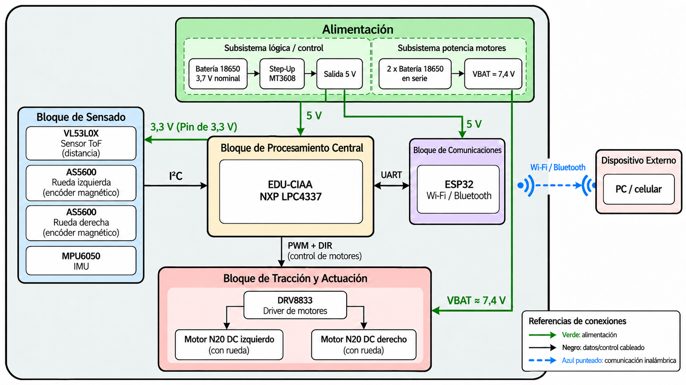

# Hardware

Este documento describe los principales componentes físicos utilizados
por Arturito y la función que cumplen dentro del sistema.

El estado actual de integración de cada componente se encuentra en
[Development Status](development-status.md).

## Componentes

| Elemento | Cantidad | Descripción y funcionalidad en el sistema
| --- | ---: | --- |
| Placa EDU-CIAA NXP  | 1 | Plataforma principal de procesamiento y control (Micro LPC4337).
| Placa NodeMCU V3 | 1 | Plataforma para comunicación con el dispositivo externo mediante módulo Wi-Fi.
| GY-521 MPU6050 | 1 | Medición inercial de 6 ejes (Acelerómetro + Giroscopio) para la estimación del ángulo de orientación del rover.
| GY-53 VL53L0X | 1 | Medición de distancia mediante tiempo de vuelo (ToF) para detección de obstáculos 
| AS5600 | 2 | Encoder magnetico para medición de posición angular de las ruedas. Permite realizar la estimación de posición en coordenadas X,Y mediante odometría.
| DRV8833 | 1 |  Doble puente H para control de potencia de los motores DC .
| Motores DC N20 con caja reductora| 2 | Tracción del rover.
| Ruedas motrices | 2 | Ruedas de goma para la tracción del rover.
| Rueda loca | 1 | Rueda para apoyo y estabilidad del chasis en el movimiento.
| Bateria 18650 recargable | 3 | Bateria Li-ion de 3.7V y 8800mAh para la alimentación de todo el sistema. Dos de ellas utilizadas en serie para la alimentación de los motores mediante el DRV8833 (Rama de alimentación). Una de ellas utilizada para la alimentación del NodeMCU y la EDU-CIAA (Rama de lógica)
| Cargador USB para Baterias 18650 | 1 | Cargador para las baterias
| Step-Up Mt3608 DC-DC | 1 | Eleva la tensión hasta 28V. Utilizado para elevar la tensión de la Rama de lógica a 5V estable para alimentación de las placas.

## Organización del hardware

## Esquemático 

El diagrama esquemático se encuentra en Arturito/KiCad/DesignSchematic.kicad_sch

La **EDU-CIAA** concentra la adquisición de los sensores y el control de los motores. El **NodeMCU** recibe información de la EDU-CIAA mediante UART por hardware y la transmite por Wi-Fi al dispositivo externo encargado de visualizar el mapa de ocupación. La conexión UART cruza transmisión y recepción: TX de cada placa se conecta a RX de la otra.

La alimentación se divide en dos ramas: dos baterías en serie alimentan el **DRV8833 y los motores**, mientras que una tercera batería alimenta la electrónica mediante un **MT3608**, cuya salida se ajusta a 5 V para la EDU-CIAA y el NodeMCU. Los sensores se alimentan desde los 3,3 V de la EDU-CIAA. Ambas ramas comparten GND para establecer una referencia eléctrica común.

El **MPU6050**, el **VL53L0X** y uno de los **AS5600** comparten el bus I²C principal. El segundo AS5600 utiliza otro bus porque ambos encoders tienen la misma dirección I²C. El pin AD0 del MPU6050 se conecta a GND para seleccionar su dirección.

Cada motor se conecta a un par de salidas del **DRV8833**. Cuatro señales desde la EDU-CIAA permiten controlar ambos puentes para establecer el sentido de giro y regular la velocidad mediante PWM. Según la comprobación realizada sobre el módulo utilizado, su habilitación por el pin EEP (sleep) se mantiene activa mediante el puente entre los contactos previstos en la placa.

Las protecciones de alimentación están pendientes de incorporación al esquemático.

