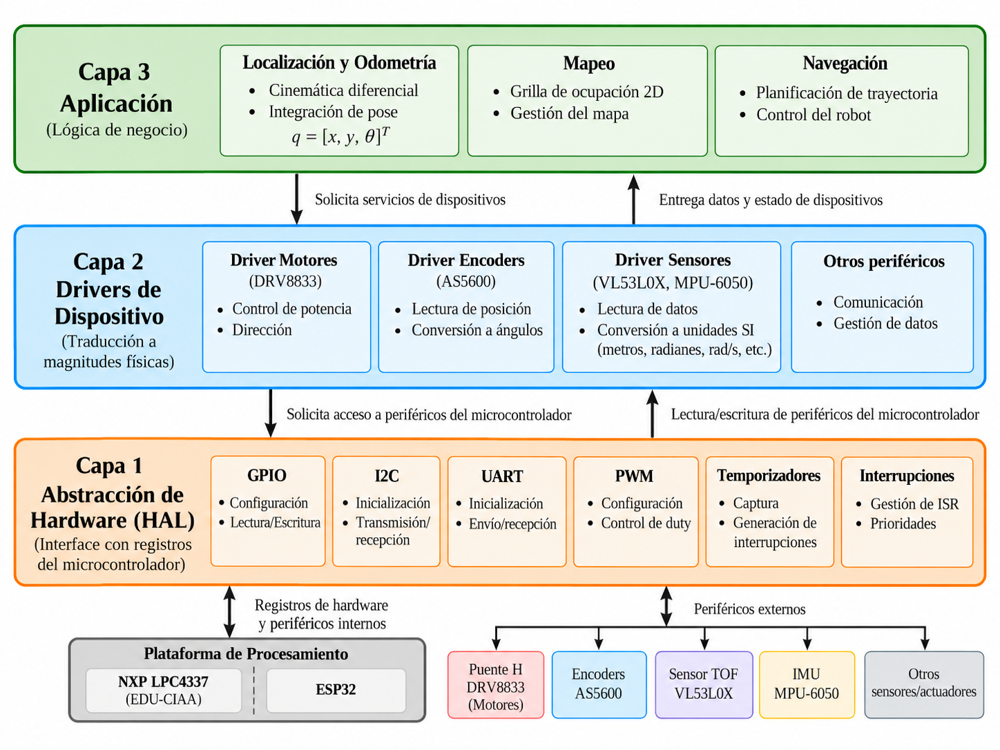

# Arquitectura de software

La arquitectura de Arturito separa la lógica del rover, el manejo de
dispositivos y los detalles específicos de cada plataforma.

## Organización

El firmware se organiza conceptualmente en tres capas:

Application → Device Drivers → HAL

## Application

Application contiene la lógica propia del sistema, incluyendo módulos
como odometría, mapeo, navegación, control y comunicaciones.

Trabaja con conceptos del dominio —pose, velocidades, mapa y comandos—
sin depender de APIs específicas de EDU-CIAA, ESP32 o de los
dispositivos utilizados.

## Device Drivers

Esta capa implementa los drivers de los dispositivos, como MPU6050,
VL53L0X, AS5600 y DRV8833. Cada driver ofrece una interfaz para
inicializar, configurar y utilizar el sensor o actuador, encapsulando
su protocolo, registros, escalas y condiciones de funcionamiento.

Cuando el acceso al dispositivo se implementa en el proyecto, el driver
utiliza servicios de HAL como lectura y escritura por I2C. Conoce los
registros del dispositivo, pero no los registros del microcontrolador
ni las APIs específicas de la plataforma.

El tratamiento realizado en esta capa se limita a la medición o actuación
propia del dispositivo: conversión a unidades físicas, corrección de
errores de medición, suavizado de ruido y comprobación de validez según
las condiciones del sensor. La estimación de orientación del rover,
la odometría, el mapa y las decisiones de movimiento corresponden a
Application. Por ejemplo, el driver de un giroscopio entrega velocidad
angular; integrar esa lectura para estimar la orientación del robot
corresponde a la aplicación.

Si se utiliza una biblioteca de dispositivo ligada a una plataforma,
el driver puede delegar ese acceso mediante un adaptador de HAL, como
se describe a continuación. Su interfaz hacia Application conserva
el mismo significado independientemente de cómo se obtenga la lectura.

## HAL

HAL abstrae las operaciones que dependen de la arquitectura del
microcontrolador y de la plataforma. Proporciona servicios como I2C,
UART, GPIO, PWM, temporización e interrupciones mediante interfaces
comunes y backends específicos de EDU-CIAA y ESP32.

En el acceso de bajo nivel, un driver de sensor utiliza una operación
como `hal_i2c_read(...)`. Su backend realiza la transferencia mediante
los registros del microcontrolador o una biblioteca de plataforma.
El driver interpreta los registros del sensor; HAL resuelve cómo se
ejecuta la transferencia en la arquitectura seleccionada.

### Adaptación de bibliotecas de dispositivos

Algunos sensores o actuadores cuentan con bibliotecas que ya resuelven
su inicialización, configuración y lectura, pero utilizan APIs propias
de una plataforma. Para aprovecharlas sin introducir esa dependencia
en el driver compartido, HAL puede actuar como una ventana entre el
driver del dispositivo y la biblioteca existente.

En esos casos, HAL expone una operación del periférico, como inicializar
un sensor o leer una distancia, y la implementa mediante la biblioteca.
Para ese acceso actúa como una **HAL de periféricos**. El driver utiliza
esa operación en lugar de implementar nuevamente las transacciones y
los registros del sensor mediante servicios como `hal_i2c_read(...)`.

Por tanto, se contemplan dos formas de acceso:

- **Driver → servicio de bus de HAL → dispositivo:** el driver implementa
  el protocolo y los registros del sensor o actuador.
- **Driver → adaptador de periférico en HAL → biblioteca existente →
  dispositivo:** la biblioteca implementa el acceso al chip y HAL adapta
  sus operaciones a una interfaz independiente de la plataforma.

Este segundo caso complementa los servicios de bajo nivel de HAL y
mantiene los drivers de dispositivos como capa diferenciada. El adaptador
preserva unidades, validez y significado de los resultados, sin añadir
lógica de odometría, mapeo o navegación.

Los backends y adaptadores pertenecen a HAL, sin constituir otra capa.
La separación y las razones para reutilizar bibliotecas se documentan
en [ADR-0001](decisions/0001-firmware-architecture.md). La selección de
plataformas se registra en [ADR-0002](decisions/0002-target-platform.md).

## FreeRTOS

FreeRTOS se considera infraestructura transversal y no una capa del
firmware.

Proporciona scheduling, temporización y mecanismos de comunicación y
sincronización entre tareas. La división en tareas no modifica las
responsabilidades de los módulos anteriores.

Siempre que sea posible, los algoritmos independientes del hardware
deben mantenerse desacoplados del RTOS para facilitar su prueba y
reutilización.

Esta decisión se documenta en
[ADR-0003](decisions/0003-freertos-runtime.md).
