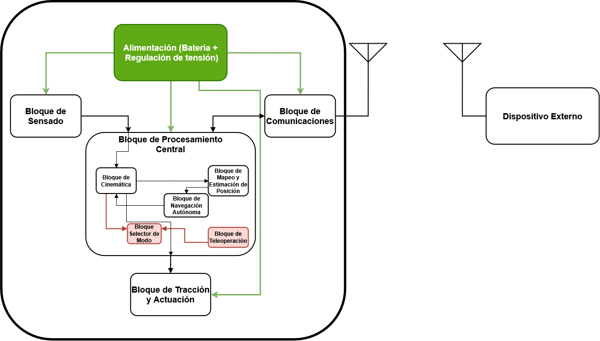

# Descripción del sistema

Arturito integra sensado, procesamiento, comunicaciones, tracción y alimentación, junto con un dispositivo externo para visualizar información e interactuar con el robot. En la siguiente imagen puede verse el diagrama de bloques por funcionalidad que conforman al sistema.

## Esquema general en bloques funcionales

Los bloques resaltados en rojo —Selector de Modo y Teleoperación— representan funcionalidades secundarias. Las conexiones verdes muestran la distribución de alimentación; las demás conexiones representan el intercambio de información y comandos.

| Bloque | Función |
| --- | --- |
| Bloque de Sensado | Recolecta mediciones de distancia e información inercial y del giro de las ruedas para entregarlas al Bloque de Procesamiento Central. |
| Bloque de Comunicaciones | Establece el enlace con el dispositivo externo para intercambiar información del mapa, estado y posición del robot, además de recibir comandos. |
| Bloque de Tracción y Actuación | Recibe comandos de movimiento y utiliza la energía de la alimentación para accionar los motores de las ruedas de forma independiente. |
| Bloque de Procesamiento Central | Integra cinemática, mapeo, estimación de posición y navegación. También contempla la selección de modo y la teleoperación como funcionalidades secundarias. |
| Alimentación (Batería + Regulación de tensión) | Proporciona y regula la energía necesaria para los sensores, el procesamiento, las comunicaciones y la actuación. |
| Dispositivo Externo | Recibe y muestra el mapa y el estado del robot; permite enviar comandos de inicio y parada. Como objetivo secundario, permite seleccionar el modo y controlar el movimiento de forma remota. |

### Bloque de Procesamiento Central

| Subbloque | Función |
| --- | --- |
| Bloque de Cinemática | Utiliza la geometría del chasis y las mediciones de ruedas e IMU para estimar la pose odométrica. También convierte las consignas de movimiento en acciones para cada rueda. |
| Bloque de Mapeo y Estimación de Posición | Combina la pose odométrica con las mediciones de distancia para construir la grilla de ocupación y proporcionar el mapa y la estimación de posición a navegación y comunicaciones. |
| Bloque de Navegación Autónoma | Evalúa el mapa y la posición del robot, selecciona hacia dónde avanzar y genera las consignas de movimiento que recibe Cinemática. |
| Bloque Selector de Modo | Selecciona el origen de los comandos de movimiento según el modo elegido: navegación autónoma o teleoperación. Es un objetivo secundario. |
| Bloque de Teleoperación | Recibe las instrucciones de movimiento enviadas desde el dispositivo externo para el control manual del rover. Es un objetivo secundario. |

## Flujo de información

El Bloque de Sensado recolecta las mediciones necesarias para conocer el entorno y el movimiento del robot, como la distancia a los obstáculos, la información inercial para determinar su orientación y la posición angular de los encoders de cada rueda. Estas mediciones se entregan al Bloque de Procesamiento Central para su tratamiento. Dentro de este, el Bloque de Cinemática utiliza el giro de las ruedas, la información inercial y las dimensiones del chasis para estimar cuánto se desplazó y giró el robot, obteniendo una estimación de su posición y orientación.

El Bloque de Mapeo y Estimación de Posición recibe esa estimación junto con las distancias medidas y la dirección en la que se tomó cada lectura. Con estos datos ubica los obstáculos respecto del robot y construye el mapa de ocupación del entorno, donde se representan las zonas libres, ocupadas y todavía desconocidas. Como resultado, proporciona el mapa y la posición estimada del robot al Bloque de Navegación Autónoma y al Bloque de Comunicaciones.

El Bloque de Navegación Autónoma utiliza el mapa y la posición del robot para identificar por dónde puede desplazarse y qué zonas quedan por explorar. A partir de esa información decide el siguiente destino o la dirección de avance y envía las consignas de movimiento al Bloque de Cinemática. Este las convierte en indicaciones para el movimiento de cada rueda, que recibe el Bloque de Tracción y Actuación para accionar los motores utilizando la energía de la alimentación. El desplazamiento producido genera nuevas mediciones de los sensores y permite repetir el ciclo.

Por su parte, el Bloque de Comunicaciones transmite el mapa, la posición y el estado del robot al Dispositivo Externo para su visualización, y recibe los comandos de inicio y parada enviados por el usuario. 
